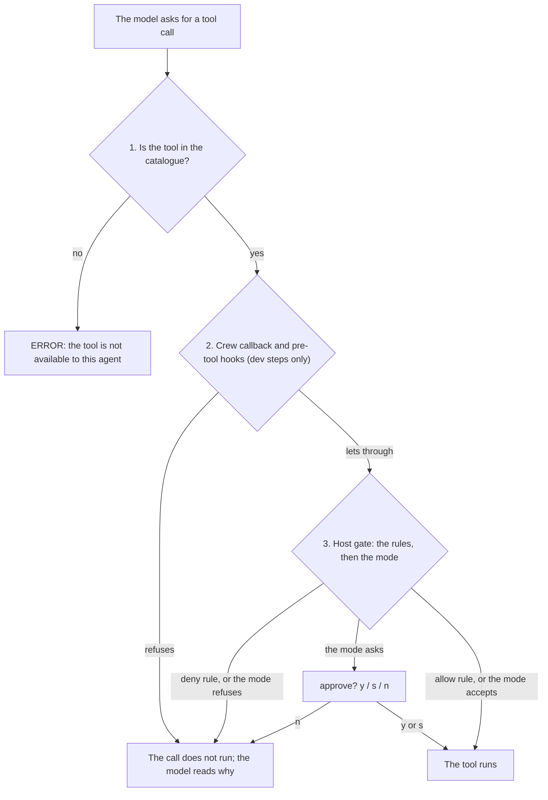

# Permissions

Chaque tour de `/assistant` s'exécute sous un **mode de permission**, et la session peut y ajouter des **règles**.
Cette page dit ce que chaque mode laisse l'agent toucher, comment en choisir un, comment écrire une règle, et ce qui
tient quel que soit le mode. Le mécanisme, règle par règle, est dans la
[Référence des permissions](permissions-reference.md).

Un appel d'outil du modèle franchit trois niveaux, le deuxième dans les seules étapes dev :



1. **Le catalogue d'outils.** Le crew offre au modèle les outils du mode, plus les
   [outils supplémentaires](#outils-supplémentaires) des classes qu'il accorde, moins ceux qu'une règle deny couvre
   en entier. Un outil qui n'est pas offert ne peut pas être appelé.
2. **Le callback du crew**, dans les étapes dev seulement : `/dev-spec`, `/dev-plan`, `/dev-batches`, et l'agent que
   `/tasks repair` relance. Il contrôle les [jeux de règles](#jeux-de-règles-des-étapes-dev) de l'étape et lance vos
   [hooks](hooks.md). Il peut refuser un appel, jamais autoriser celui que la garde refuse.
3. **La garde du runtime.** Le runtime Orkeon contrôle chaque appel d'outil que le modèle fait dans un tour, ceux de
   la boucle `act` de l'agent. Il lit les règles de la session d'abord, puis le mode, d'après l'accès que chaque
   outil déclare (lecture, modification, exécution). Quand le mode dit de demander, il vous demande.

> [!WARNING]
> La garde est le réglage `Orkeon:Security:PermissionGate:Enabled`. Le lanceur l'active, sauf si votre fichier de
> settings la désactive ; sans elle, ni les modes ni les règles ne sont appliqués. Laissez-la active.

## Modes

| Mode | Offert au modèle | Lectures locales | Lectures réseau (`http_api`, web) | Modifications de fichiers (`file_write`, `edit_file`, `node_*`, `edit_batch`, `structural_rewrite`), `rag_ingest` | Shell |
|---|---|---|---|---|---|
| `plan` | lectures locales, [outils supplémentaires](#outils-supplémentaires) `read` | ✅ | ❌ | ❌ | ❌ |
| `dontAsk` | lectures locales, [outils supplémentaires](#outils-supplémentaires) `read` | ✅ | ❌ | ❌ | ❌ |
| `default` | tous les outils | ✅ | GET simple de `http_api` ✅, ses autres méthodes vous sont demandées, web ✅ | vous est demandé | vous est demandé |
| `acceptEdits` | tous les outils | ✅ | GET simple de `http_api` ✅, ses autres méthodes vous sont demandées, web ✅ | ✅ | vous est demandé |
| `bypassPermissions` | tous les outils | ✅ | ✅ | ✅ | ✅ |

`plan` et `dontAsk` promettent que le tour ne change rien d'observable : aucune écriture, et aucune requête
sortante, puisqu'une requête peut emporter ailleurs le contenu du dépôt. Leur catalogue ne contient que les outils
de lecture locale, et la garde refuse tout le reste sans demander.

### Questions

En `default` et en `acceptEdits`, un appel sur lequel le mode demande votre avis vous attend dans le REPL :
`approve <tool>? [y] once / [s] session / [n] no`.

| Réponse | Effet |
|---|---|
| `y` | exécute l'appel |
| `s` | exécute l'appel, puis tous les appels suivants de cet outil sans demander, jusqu'à la sortie du REPL |
| `n` | refuse l'appel ; le modèle lit le refus et s'adapte |

Une ligne en `/` lance toujours sa commande pendant qu'une question attend. Une ligne qui n'est pas une réponse fait
réécrire la question entière.

### Questions d'une tâche d'arrière-plan

La question d'une commande qui tourne en arrière-plan (`/dev-batches`) nomme sa tâche :
`? [t1] dev-batches: tool 'shell_command' requires approval (mode 'acceptEdits').`, l'appel, puis
`approve shell_command for [t1]? [y] once / [s] session / [n] no`.

- Elle s'affiche sur la ligne d'état et sur la ligne de la tâche (`? waits for approval of shell_command`).
- Vous y répondez depuis le prompt principal, sans ouvrir la tâche.
- Dans la TUI, où chaque tâche a son écran, la question s'affiche sur l'écran affiché, quelle que soit la tâche qui
  demande. Elle est consignée une fois sur l'écran de la tâche qui demande.
- `/tasks` liste les approbations en attente sous la liste des tâches : `waiting for approval:` puis
  `t1 dev-batches: waits for approval of shell_command · {"command":…}`. Une tâche bloquée sur vous se lit ainsi
  comme telle.

### Ce que chaque outil déclare

La garde décide d'après l'accès qu'un outil déclare : une lecture s'exécute partout où le catalogue offre l'outil,
une modification et une exécution suivent la colonne du mode dans le tableau ci-dessus. Un outil qui ne déclare ni
lecture ni modification compte pour une écriture. Quand l'accès dépend des arguments, la garde le lit appel par
appel.

| Outil | Lecture | Modification | Exécution |
|---|---|---|---|
| `http_api` | `GET`, `HEAD`, `OPTIONS`, méthode absente | | toute autre méthode ; une méthode de lecture avec un corps ou un en-tête de substitution de méthode |
| `github` | `list_issues`, `get_pr`, `search_repos`, `get_repo` | | `create_issue`, `create_pr`, une action qu'il ne connaît pas |
| `web_scrape`, `scrape_element`, `rag_search` | tout appel | | |
| `rag_ingest`, `rag_eval` | | tout appel | |
| `firefox` | `navigate`, `back`, `snapshot`, `read`, `find`, `search`, `tabs`, `new_tab`, `switch_tab` | `screenshot` | `click`, `type`, `press`, `evaluate`, `close_tab`, `close` |
| `spawn_agent` | | tout appel | |
| `memory_recall` | tout appel | | |
| `memory_push` | | tout appel | |
| un outil MCP | ce que disent ses annotations, une fois son serveur de confiance ([Outils supplémentaires](#outils-supplémentaires)) | | |

Ce que le tableau ne dit pas, outil par outil :

- **`http_api`.** Un corps compte même vide. Les en-têtes de substitution de méthode sont `X-HTTP-Method-Override`,
  `X-HTTP-Method` et `X-Method-Override`, quelle que soit la casse, dans un objet ou une chaîne JSON. Un GET simple
  s'exécute donc sans question en `default` et en `acceptEdits` ; un POST, ou un GET avec un corps, vous est demandé.
- **`rag_ingest`.** Il écrit l'index de connaissances, pas l'espace de travail. Le catalogue l'offre avec les
  modifications de fichiers : jamais en `plan` ni en `dontAsk`, demandé en `default`, accepté en `acceptEdits`.
- **`github` et `rag_eval`.** Ils sont offerts avec les modifications de fichiers, dans les seuls modes qui écrivent,
  quoi qu'un appel déclare. `github` peut ouvrir une pull request ; `rag_eval` ingère son corpus dans une collection
  de l'index de connaissances et écrit ses rapports. Aucun des deux n'a sa place dans un mode qui promet que rien ne
  change.
- **`spawn_agent`.** Le runtime l'offre à chaque act, quel que soit le catalogue : demandé en `default`, refusé en
  `plan` et en `dontAsk`. Une règle peut le nommer, et une règle allow sur lui vaut aussi en `dontAsk` (`/permissions`
  avertit quand vous en ajoutez une). L'enfant qu'il lance tourne sous le plus strict de son propre mode et de celui
  de son parent. Les enfants d'Orkeon Code n'en nomment aucun : ils prennent celui du parent.

### Outils réseau

`http_api` et les outils web restent hors de `plan` et de `dontAsk` pour une seule raison : un GET est une requête
sortante, qui peut emporter ailleurs le contenu du dépôt.

> [!WARNING]
> En `default`, un GET simple de `http_api` s'exécute sans question, et son URL peut contenir du texte que le modèle
> a lu dans le projet. Un projet qui ne doit rien envoyer au-dehors refuse l'outil (`/permissions add deny http_api`,
> une règle deny qui tient dans tous les modes), ou travaille en `plan` ou en `dontAsk`, dont le catalogue l'écarte.

`firefox` est aussi un outil réseau : `plan` et `dontAsk` ne l'offrent jamais, puisque charger une page est une
requête sortante. Là où il est offert, son `action` décide, comme le dit le tableau : `default` demande pour un
`screenshot`, `acceptEdits` l'accepte. Sa propre politique d'URL refuse les adresses privées et de bouclage.
L'installation est décrite dans [Configuration](configuration.md#les-settings-dont-orkeon-code-dépend).

> [!WARNING]
> Le texte d'une page parvient au modèle sans filtrage contre l'injection de prompt : lire une page qui n'est pas de
> confiance demande la même prudence que `web_scrape`. Un secret ne passe jamais par `type`, dont le texte reste dans
> la transcription.

### Les outils de la mémoire partagée

Les deux outils de la [mémoire partagée](shared-memory.md) sont ceux d'Orkeon Code, offerts aux tours du REPL selon
le mode.

- `memory_recall` s'exécute dans tous les modes, `plan` et `dontAsk` compris.
- `memory_push` écrit un fichier candidat sous `memory.dir`, jamais une entrée admise. Il est offert là où le mode
  modifie : jamais en `plan` ni en `dontAsk` (l'outil refuse aussi de lui-même dans ces modes), demandé en `default`,
  accepté en `acceptEdits`.

Une règle peut les nommer, en entier ou sur un argument de leur schéma : `/permissions add deny memory_push`,
`deny memory_push topic=auth*`, `deny memory_recall query=*secret*`. Une règle deny sur l'outil entier le retire aussi
du catalogue.

## Choisir le mode

- **Par requête** : préfixez le texte, `plan: explain the cache layer`, `acceptEdits: fix the failing test`.
- **Pour la session** : `/mode acceptEdits`. `/mode` seul ouvre un panneau des modes dans la console ; sur un rejeu
  ou une console simple, il fait défiler `default`, `acceptEdits`, `plan` et `bypassPermissions`, jamais `dontAsk`
  (on y accède par `/mode dontAsk`). `/plan`, alias de `/mode`, bascule le mode plan.
- **Repli** : sans l'un ni l'autre, le mode est `default`, ou celui que fixe
  `/config set permissions.fallback <mode>` (`--session` le garde pour la seule session). Chaque tour qui utilise le
  repli dit quel mode s'est appliqué et d'où il vient.

La commande qui démarre le tour (`/assistant`, texte libre) résout le mode avant le chargement du crew. Le
catalogue, la note de permission du prompt et la garde appliquent donc le même mode : après `/mode plan`, une
requête sans préfixe reçoit le catalogue de `plan`. `/summary` ne résout pas le mode de la session : il lance
toujours le crew principal en `plan`.

`/permissions` montre la surface effective : le mode, le catalogue, les règles de la session et celles que la garde
détient. Il interroge aussi le runtime et dit si la garde est active ou non ; inactive, rien de ce que décrit cette
page n'est appliqué et rien ne vous est demandé. Le runtime le signale toujours.

## Règles

Une règle nomme un outil, intégré ou [supplémentaire](#outils-supplémentaires), et au besoin un motif d'argument.

```text
/permissions add deny shell_command command=git push*
/permissions add allow shell_command command=npm test*
/permissions add deny http_api
/permissions remove allow shell_command command=npm test*
/permissions list
/permissions clear
```

### Écrire une règle

- Le motif est comparé en entier à l'argument que passe le modèle. `*` vaut pour toute suite de caractères, et la
  casse compte.
- Un motif peut être entre guillemets : une paire de guillemets assortis est retirée, si bien que
  `command="npm test*"` vaut `command=npm test*`.
- L'argument porte le nom sous lequel Orkeon le lie, en snake_case. Pour un outil intégré, `/permissions add` refuse
  un argument que l'outil ne prend pas et liste ceux qu'il prend.
- Les arguments d'un outil supplémentaire sont ceux de son serveur ou de son plugin. La règle est acceptée avec un
  avertissement, et ne s'applique que si l'outil prend un argument de ce nom exact.

| Outil | Arguments qu'une règle peut nommer |
|---|---|
| `shell_command` | `command`, `working_directory`, `timeout_seconds` |
| `file_write` | `path`, `content`, `encoding`, `append`, `create_backup` |
| `http_api` | `url`, `method`, `headers`, `body`, `content_type` |

Une règle lit un seul argument de premier niveau, comme du texte. Ce que cela laisse de côté, et comment les étapes
dev comblent l'écart, figure sous [Ce que lit une règle](permissions-reference.md#ce-que-lit-une-règle).

### Comment la garde les lit

La garde lit les règles avant le mode, à chaque appel :

- une règle **deny** refuse l'appel qu'elle couvre dans tous les modes, `bypassPermissions` compris ;
- une règle **allow** exécute sans demander l'appel qu'elle couvre, dans tous les modes sauf `plan`, dont la garde
  n'en lit aucune ;
- un appel qu'aucune règle ne couvre est décidé par le mode.

Ajouter une règle remplace la règle d'effet contraire sur les mêmes appels ; les règles portant sur d'autres appels
du même outil restent.

### Les règles et le catalogue

| Règle | Effet sur le catalogue |
|---|---|
| une règle deny qui couvre tous les appels d'un outil | retire l'outil : le modèle ne reçoit pas un outil dont chaque appel serait refusé |
| une règle deny avec un motif | laisse l'outil offert, puisque ses autres appels s'exécutent |
| une règle allow | n'ajoute jamais d'outil : elle épargne une question, elle ne donne pas un outil que le mode écarte |

`plan` et `dontAsk` restent donc en lecture seule quoi que disent les règles. `/permissions` signale une règle allow
sans effet dans le mode de la session : toute règle allow en `plan`, et une règle allow sur un outil que le mode
n'offre pas. Un tour signale celle qui n'en a pas dans le mode que nomme sa requête, et chaque tour consigne les
outils qu'une règle a retirés.

### Combien de temps elles durent

Les règles vivent dans l'état de la session jusqu'à `/clear` ou à la fin du REPL ; les conserver d'une session à
l'autre est sur la [Feuille de route](roadmap.md). La garde en tient sa propre copie, que `/permissions` remplace
après chaque changement et que chaque `/assistant` remplace avant le début du tour : elle détient donc toujours les
règles de la session. Une réponse `[s]` n'est pas une règle : `/permissions` ne la liste pas et ne l'efface pas.

## Les protections qui tiennent dans tous les modes

La session ajoute à la garde des règles deny qui lui sont propres, dans tous les modes, `bypassPermissions` compris.

### La protection de la mémoire partagée

Aucun outil de fichiers du modèle (`file_write`, `edit_file`, `node_replace`, `node_insert`, `node_ensure`) n'écrit
sous `<memory.dir>/candidates/` ni sous `<memory.dir>/entries/`. Les candidats viennent de `memory_push` et des
récoltes, les entrées du seul `/memory admit`.

- Une règle allow enregistrée que la protection couvre est écartée, avec un avertissement.
- Les motifs s'appliquent quelle que soit l'écriture du chemin (`./`, `//`, `src/../`, `/workspace/`).
- Un `shell_command` qui nomme `<memory.dir>/candidates` ou `<memory.dir>/entries` est refusé lui aussi.
- `/permissions` liste la protection sur une ligne à part, "the shared memory's guard: … (N rules)".

Ce que la garde ne peut pas voir, le callback de la boucle principale et de chaque crew dev le refuse à chaque
appel, sous `orkeon run` aussi :

| Cas | Exemple |
|---|---|
| un chemin dans une autre casse, qu'un système de fichiers insensible à la casse ouvre | `.Orkeon/Memory/Entries/x.md` |
| chaque opération d'un `edit_batch` | |
| les chemins et le glob d'un `structural_rewrite` qui écrit | `dry_run: false` |
| une commande shell qui atteint le dossier segment par segment, quelle que soit la casse | `cd .orkeon/memory && … > entries/x.md`, `.orkeon//memory/entries` |

Un glob qui tient lieu de segment (`cp x .orkeon/mem*/entries/`) n'est pas lu : le shell le développe après tous les
contrôles. Un crew sans callback (`/code-review`, `/advisor`) tourne sous les seules règles de la garde.

### La protection de la configuration de l'utilisateur

La session refuse à tout outil du modèle le montage `/user-config` entier : les lecteurs et les rédacteurs de
fichiers sur `/user-config/*`, les lecteurs de dossiers sur le montage, un `shell_command` qui le nomme. Le lanceur
y écrit les réglages de l'utilisateur et `launch.json`, la base physique de chaque montage
([architecture](architecture.md#le-vfs-et-la-plateforme-hôte)), que le modèle ne voit jamais.

Le code les lit par son propre port, que la garde ne voit pas. `/permissions` liste ces règles sous "the user
configuration's guard: no tool of the model reads or writes /user-config (N rules)".

### Les listes de chemins

`paths.deny` nomme les chemins qu'aucun outil du modèle ne lit ni n'écrit, `paths.allow` les seuls chemins qu'il
peut atteindre. Ce sont deux clés de `/config` ([configuration](configuration.md#réglages-de-session)), fixées par
les réglages de l'utilisateur et le fichier du projet, appliquées au prochain démarrage :

```text
paths.deny:  /workspace/secrets, C:\proj\keys\*, tests/fixtures/real
paths.allow: src, tests, /output
```

Comment s'écrit une entrée :

- Les entrées sont séparées par des virgules. Un chemin peut contenir des espaces, écrit tel quel, sans guillemets.
- Une entrée est un chemin virtuel, une écriture physique de la base d'un montage (`C:\…`, `/mnt/c/…`, `\\wsl$\…`)
  ou un chemin relatif à `/workspace`.
- `*` vaut pour toute suite de caractères. Un chemin nu couvre lui-même et tout ce qui se trouve dessous.

Comment les listes sont lues :

- Les entrées sont comparées sur l'écriture canonique, sans casse sur un disque Windows : aucune écriture ne les
  contourne.
- Une entrée qui n'est sous aucun montage de cette machine est écartée, et la ligne `host: paths` de `/doctor` la
  nomme.
- Un deny l'emporte sur un allow. Un allow non vide refuse tout chemin hors de lui, sur chaque montage. Un mot d'une
  commande shell qui n'est sous aucun montage, comme `/dev/null`, n'est pas jugé.

Les entrées deny deviennent des règles deny de la garde, que `/permissions` liste sur une ligne à part : "paths.deny:
no tool of the model reads or writes … (N rules)". Dans chaque crew, y compris ceux qui n'ont pas de callback
propre, les callbacks du runtime refusent aussi ce que les listes couvrent, sous toute écriture : un appel, chaque
opération d'un `edit_batch`, ce qu'un lecteur de dossiers atteint, et les mots d'une commande shell. Le refus nomme
les deux écritures et l'entrée :
"file_read on 'C:\proj\secrets\k' (/workspace/secrets/k) is refused by paths.deny '/workspace/secrets/*'".

> [!NOTE]
> Sur une commande shell, le contrôle fait au mieux : ce qu'un script atteint de lui-même lui échappe.

## Ce que la garde ne voit pas

Les commandes et les crews appellent aussi des outils depuis leur propre code, par l'espace de noms `tools`
d'Orkeon, qui exécute l'outil directement. Ces appels sont la raison d'être de la commande que vous avez tapée :
aucune règle, aucun mode, aucune question ne s'y applique, sauf quand la commande contrôle d'elle-même, comme le dit
le tableau.

| Commande | Ce qu'elle exécute depuis son propre code | Son propre contrôle |
|---|---|---|
| `/commit` | `git add`, `git commit` et, avec `--push`, `git push`, par `shell_command` ; avec `--pr`, `create_pr` de `github` | refuse en `plan` et en `dontAsk` ; décide de la pull request comme le ferait la garde |
| `/branch` | bascule sur une branche | aucun |
| `/diff`, `/review` | `git` | aucun |
| `/init` | écrit le fichier d'instructions | aucun |
| `/init-verifiers`, `/export` | écrivent leurs fichiers | aucun |
| la compaction | écrit le tampon de session et la mémoire typée | aucun |
| `/transcribe` | les outils du serveur de transcription | aucun : tous les modes, sans entrée dans `tools.extra` |
| `/voice`, `/say`, `voice.reply on` | enregistrent, lisent à voix haute | aucun |
| `/dev-learn` | lit les fichiers de verdict et les deux états d'apprentissage, écrit ses propres fichiers | aucun |
| `/dev-spec` | lit la demande, le pack et l'index du code, écrit la spec ou la fiche de changement | refuse de démarrer dans un mode en lecture seule |
| `/dev-plan` | lit la spec ou la fiche, le pack et l'index du code, écrit le plan | refuse de démarrer dans un mode en lecture seule |
| `/dev-batches`, un lot | le restore, le build et la suite du pack, puis la clôture : commit et push | refuse de démarrer dans un mode en lecture seule |
| `/dev-batches`, l'audit | `git`, le build du pack et les commandes de test qu'il accepte | aucun : tous les modes |

`/dev-spec`, `/dev-plan` et `/dev-batches` refusent de démarrer dans un mode en lecture seule (`plan`, `dontAsk`),
dans un mode qu'Orkeon Code ne connaît pas, et quand le mode de la session ne peut pas être lu. Toutes trois placent
d'abord dans la garde les [jeux de règles des étapes dev](#jeux-de-règles-des-étapes-dev), et refusent de démarrer
tant que la garde est inactive. Le callback de leur crew contrôle à nouveau les mêmes jeux : c'est leur seul contrôle
sous `orkeon run`.

### `/commit`

`/commit` indexe par leur nom les fichiers qu'il commite (`git add -- <files>`, puis
`git commit -F <message> -- <files>`, jamais `-A`) et, avec `--push`, pousse. Avec `--pr`, il lit origin
(`git remote get-url origin`) et appelle lui-même `create_pr` de `github`. Il décide de cet appel comme le ferait la
garde :

| Cas | La pull request |
|---|---|
| `plan` | refusée |
| `dontAsk` sans règle allow | refusée |
| une règle deny couvre l'appel | refusée |
| une règle allow (`allow github action=create_pr`) | ouverte |
| `bypassPermissions` | ouverte |
| vous avez répondu oui à son plan, qui nommait la pull request | ouverte |

`--yes` ne demande rien : il lui faut donc la règle allow.

Ses commandes git sont `git -c core.quotePath=false status`, `git --literal-pathspecs add` et `commit`, `git var`,
`git rev-parse`, `git symbolic-ref` et `git push -u origin <branch>` ; pour les lots lancés dans des worktrees,
s'y ajoutent `git merge --ff-only` et `git -C <worktree> rebase`. Elles ne s'exécutent que sous
`Orkeon:Tools:Shell:AllowInterpreters` : sans lui, l'outil shell ne laisse git lancer que `status`, `log`, `diff` et
`show`, sans option devant.

### Les commandes de la voix

- `/transcribe` appelle les outils du serveur de transcription dans tous les modes. Avec `--then`, la boucle
  principale fait cet appel avant le tour, au titre de la commande ; le modèle travaille ensuite sur la transcription
  sous le mode du tour.
- `/voice` enregistre de la même façon. `/voice send` remet le texte dicté à un tour comme le ferait un texte tapé :
  un `plan:` en tête, en minuscules, choisit le mode.
- `/voice --go` le remet à un tour sous le mode de la session, choisi avant l'enregistrement : aucun préfixe dicté
  n'est lu.
- `/say` lit à voix haute de la même façon. Il en va de même de la lecture de chaque réponse sous `voice.reply on`,
  faite par la boucle principale après le tour, au titre de la commande qui l'a lancé.

### Ce que chaque étape dev lit et écrit

| Étape | Lit | Écrit, et rien d'autre |
|---|---|---|
| `/dev-learn` | les fichiers de verdict et les deux états d'apprentissage | `<work>/learn-<date>/`, `.orkeon/dev-learn-state.json`, `refused.md` sous `memory.dir` |
| `/dev-plan` | la spec ou la fiche de changement, le pack, l'index du code | `<work>/<code>/<CODE>-PLAN.md`, les fiches de lot, `plan.json` |
| `/dev-spec` | la demande (une issue par `gh issue view`), le pack, l'index du code | `<work>/<code>/SPEC-<code>.md`, ou `CHANGE-<code>.md` et `repro-<code>.txt` |

- `/dev-learn` n'écrit jamais un fichier sous `.claude/`, ni le fichier que nomme une proposition.
- `/dev-plan` n'écrit jamais un fichier sous `.claude/`. Son relecteur ne fait que lire, en `plan`, avec les outils
  de lecture.
- Pour une fiche de changement, `/dev-spec` lance depuis son propre code la commande de reproduction ou de mesure,
  une fois que les jeux de règles de l'étape l'autorisent : une commande de test étroite du pack.

### Un lot de `/dev-batches`

Un lot (`<code> F<n>`) lance le restore, le build et la suite du pack depuis son propre code. Ses deux rôles écrivent
en `acceptEdits`, chacun dans ses racines. Après un verdict VALID, sa clôture commite par leur nom les fichiers que
les rôles ont changés, puis pousse la branche, sauf si une règle de la session refuse le push. Le lot remet le
contrôle de la garde et ses règles avant chaque lancement de sa chaîne : l'audit, puis la clôture.

L'audit (`<code> F<n> --audit`) lance `git`, le build du pack et les commandes de test qu'il accepte depuis son
propre code, dans tous les modes. Son auditeur ne fait que lire, en `plan`, avec les outils de lecture.

### Un plan de `/dev-batches`

`/dev-batches` déroule cette chaîne pour chaque lot d'un plan, sous les mêmes jeux de règles.

- La clôture de chaque lot commite sans pousser, y compris une clôture tapée pendant que le plan tourne.
- La clôture du plan pousse la branche une fois, sauf si une règle de la session refuse le push. Elle ouvre une
  seule pull request (`--pr` ou `dev.prAuto`), sinon elle vous remet la commande.
- Sur la branche par défaut, elle ne pousse rien et vous remet le push.
- Chaque lot tourne sous son propre budget d'appels d'outils, de temps réel et de tokens.
- Un verdict GAPS relance aussitôt son lot dans son worktree, ses lignes Blocking et Major servant de correction,
  jusqu'à trois tours d'audit en GAPS.
- Un lot qui s'arrête (BLOCKED, ou un troisième tour d'audit encore en GAPS) garde son worktree ; son code, sa fiche
  et son verdict n'existent que là. Les dernières lignes de l'exécution le nomment, avec la commande qui le relance
  sur place (`/dev-batches <code> --concurrency <n>`, la correction d'un verdict GAPS d'abord), pour qu'un humain
  décide.

Avec `--concurrency` de 2 à 4, il lance une vague de lots à la fois, chacun dans un agent de lot sous son propre
worktree (`.orkeon/worktrees/<code>-F<n>`, sur la branche `batches/<code>/F<n>`). Trois conditions, chaque refus en
une ligne, avant tout lot :

| Condition | Pourquoi |
|---|---|
| le mode est `bypassPermissions` | deux lots demanderaient en même temps |
| git fonctionne dans le worktree d'un lot (une première sonde le vérifie) | un bac à sable peut ne pas monter le répertoire git du worktree |
| tout `.orkeon/` est ignoré par git (`.gitignore` ou `.git/info/exclude`) | les worktrees et l'état dev qui y est amorcé s'y trouvent |

## Jeux de règles des étapes dev

`/dev-spec`, `/dev-plan` et `/dev-batches` (sauf `--audit --gate-only`) remettent à la garde leurs propres jeux de
règles juste avant le démarrage de leur crew, et le callback du crew les contrôle à chaque appel, avant la garde.
Un jeu est une liste de règles deny intégrée à Orkeon Code, la même dans tous les dépôts ; aucun réglage n'en active
ni n'en désactive un. Chaque étape les met tous en vigueur :

| Jeu | Règles sur | Refuse |
|---|---|---|
| `git-readonly` | `shell_command`, `command` | une commande git qui change le dépôt, ses branches ou ses remotes, y compris derrière une option globale (`git -C <dir> push`) |
| `inline-interpreters` | `shell_command`, `command` | du code passé en ligne à un interpréteur, qui pourrait exécuter ce que les autres règles refusent |
| `read-noise` | `path` de `file_read`, `glob`, `grep`, `node_outline`, `node_read`, `count_pattern`, `documents_of`, `directory_search` | une lecture sous un dossier `bin/`, `obj/`, `.git/` ou `node_modules/`, où qu'il soit dans le projet |
| `secrets` | le texte écrit : `content` de `file_write`, `new_string` de `edit_file`, `text` de `node_replace`, `node_insert` et `node_ensure`, `name` et `module` de `node_ensure`, `fix` de `structural_rewrite` ; le `text` de chaque opération d'un `edit_batch`, par le callback | un contenu qui renferme un bloc de clé privée ou un jeton à préfixe connu |
| `state-files` | `path` de `file_write`, `edit_file`, `node_replace`, `node_insert`, `node_ensure`, le `path` de chaque opération d'un `edit_batch` par le callback ; `structural_rewrite` en entier | un fichier que seul le code d'Orkeon Code écrit : les journaux, états et verdicts de lot, les captures d'audit, `.orkeon/` (sauf `worktrees/`) et `.claude/` |

Chaque règle de chaque jeu, et ce que chacun laisse passer, figure dans la
[référence](permissions-reference.md#les-jeux-de-règles-règle-par-règle).

### Ce que vous voyez quand un jeu refuse

Un appel que la garde refuse porte le refus de la garde. Un appel que seul le callback refuse nomme la règle, son
jeu et ce qu'il faut faire à la place : un `glob` ou un `grep` qui atteint un chemin refusé, un chemin écrit avec
`./` ou `..`, et tout appel sous `orkeon run`.

La lecture de l'historique reste ouverte dans chaque étape : `git status`, `git log`, `git diff`, `git show`.

### Quand ils tiennent

- Au lancement, l'étape vide la garde, lui remet les règles de la session, puis ses propres jeux.
- Une règle allow de la session qui porte sur les mêmes appels qu'une règle deny de l'étape est laissée de côté le
  temps de l'exécution, avec un avertissement.
- Les jeux ne sont pas enregistrés avec les règles de la session. `/permissions list` ne les montre pas ;
  `/permissions` les montre sur sa ligne `in the host gate`, groupés par jeu, tant qu'ils y restent.
- Ils restent jusqu'au prochain tour de `/assistant` ou au prochain `/permissions add`, `remove` ou `clear`, qui
  remettent à la garde les seules règles de la session.
- Comme toute règle, ils valent pour la session entière : un tour lancé pendant qu'une étape tourne les remplace
  pour le reste de l'étape.

Un `/tasks repair` remet à la garde les jeux de l'étape qui a lancé l'instance. Un relecteur de `/dev-spec` est
réparé sous les jeux, les hooks et le budget de cette étape, sinon sous ceux de l'étape de sa charte.

### Ce qu'un lot ajoute

Un lot de `/dev-batches` place les mêmes jeux dans la garde, et deux règles allow qui lui sont propres : `run_tests`
et `run_build`. Chacun contrôle lui-même sa commande d'après le pack et les règles deny ; les rôles, qui agissent en
`acceptEdits`, ne sont donc pas interrogés à chaque lancement de tests. Les règles allow quittent la garde avec les
jeux de l'étape.

Les deux rôles qui écrivent (l'auteur des tests et l'implémenteur) portent aussi une **règle de réécriture** :
`deny file_write` sur chaque racine de sources que nomme le `layout` du pack (`domain`, `application`,
`infrastructure`, `tests`) et sur chaque motif de `layout.test_files`.

- Un fichier source existant se modifie par nœud (`node_read` pour son `sha256`, puis `node_replace`, `node_insert`
  ou `node_ensure`) ou avec `edit_file`, jamais en le réécrivant en entier.
- Avant un `file_write` à cet endroit, le callback lit le chemin une fois. Quand le runtime répond que le fichier
  n'existe pas, la règle est levée pour cet appel : un fichier neuf (un stub, un nouveau fichier de test) se crée
  donc toujours avec `file_write`. Toute autre réponse maintient la règle.

Le pilote d'un lot est tenu hors des racines de sources que nomme le pack : il reçoit les mêmes règles deny sur
chaque outil de lecture par chemin, `directory_search` compris. `structural_search` et `symbol_source`, qui ne
nomment aucun chemin, sont refusés en entier.

### La garde doit être active

Quand le runtime indique que sa garde est inactive, les étapes refusent de démarrer : chaque règle ci-dessus, et le
mode `plan` de leur auditeur ou de leur relecteur, ne contrôlerait rien.
`/dev-batches <code> F<n> --audit --gate-only` ne lance aucun modèle et s'exécute quand même.

Sur un runtime qui ne garde aucune règle de session, l'étape tourne avec un avertissement : les jeux ne sont pas
dans la garde, et seul le callback du crew les contrôle.

### Ce qu'une règle ne peut pas voir

Une règle lit un argument comme du texte.

- Un fichier de script lancé par un interpréteur (`bash scripts/build.sh`) n'est pas du code en ligne, et s'exécute.
- `secrets` ne connaît que des préfixes fixes. Un jeton JWT, un mot de passe dans une URL ou une ligne
  `api_key = …` demandent un contrôle du contenu entier, qui attend un outil de fichiers propre à Orkeon Code.
- Un contenu qui mentionne un préfixe, comme une page ou un test au sujet des jetons, est refusé lui aussi.
- `read-noise` refuse aussi un dossier de sources qui se trouve s'appeler `bin/`.
- Comme une règle lit `sh -c` à la fin de n'importe quel mot, `ssh -c <cipher>` est refusé lui aussi.

Dans la garde, une tabulation entre deux mots, ou un ordre d'options qu'une règle ne liste pas, passe. Le callback
des crews en rattrape une partie : voir
[Ce que le callback lit au-delà de la garde](permissions-reference.md#ce-que-le-callback-lit-au-delà-de-la-garde).

## Outils supplémentaires

Les outils qu'un serveur MCP ou un plugin apporte au REPL (les settings `MCP:Servers` et `Plugins` d'Orkeon, voir
[Configuration](configuration.md#outils-supplémentaires--serveurs-mcp-et-plugins)) sont offerts au modèle dès que le
réglage `tools.extra` les nomme, chacun avec une classe d'accès :

| Classe | S'écrit | Offert en |
|---|---|---|
| `read` | `transcribe_audio:read` | tous les modes, avec les lectures locales |
| `write` | `search_issues`, `create_issue:write` | `default`, `acceptEdits`, `bypassPermissions` |

Un nom sans classe est une écriture. Un outil intégré garde sa propre classe et ne peut pas être listé.

> [!WARNING]
> Ne marquez `read` qu'un outil qui ne change rien et n'envoie rien hors de la machine : c'est ce que promettent
> `plan` et `dontAsk`.

### Les noms contrôlés avant chaque tour

Avant chaque tour, `/assistant` et `/summary` comparent les noms à ceux que le runtime enregistre, comme Orkeon les
compare : à la casse près, mais exactement, si bien que `get_file_contents` n'est pas le `get-file-contents` qu'un
serveur MCP enregistre. Le tour reçoit l'écriture enregistrée.

Un nom que le runtime n'enregistre pas (un serveur qui ne s'est pas connecté, un plugin qui ne s'est pas chargé, une
faute de frappe) est écarté avec un avertissement, puisqu'Orkeon refuse un tour dont l'agent nomme un outil qu'il ne
connaît pas.

### Un outil que le runtime n'enregistre que sur demande

Un outil qu'`orkeon-repl` n'enregistre que si une section des settings le demande passe lui aussi par `tools.extra` :
un catalogue qui nomme un outil que le runtime n'a pas enregistré fait échouer l'act avant que le modèle soit
interrogé.

`system_one_decide`, le modèle de décision System One du runtime (TypeSafe, Liquid ou Kev), en est un : il est
enregistré quand un fournisseur de décision est actif (sa section, sa clé ou `Orkeon:Decision:Provider`) et n'est
dans aucune liste intégrée. L'utilisateur dont le runtime l'a le liste dans `tools.extra`.

Il déclare une lecture à la garde, et s'exécute donc sans question partout où le catalogue l'offre. Gardez-le en
écriture dans la liste : il envoie l'état qu'on lui donne à l'API du fournisseur de décision, ce que `plan` et
`dontAsk` promettent que rien ne fait.

### Ce que déclare un outil MCP ou de plugin

La classe façonne le catalogue ; la garde décide toujours de chaque appel d'après l'accès que l'outil déclare à
Orkeon. Un outil MCP le déclare par ses annotations, lues seulement quand son serveur est déclaré avec
`TrustAnnotations: true` (`MCP:Servers:<name>:TrustAnnotations`, false par défaut).

| L'outil | Accès | Effet |
|---|---|---|
| serveur de confiance, `readOnlyHint: true` | lecture | s'exécute sans question dans tout mode qui offre l'outil, `dontAsk` compris |
| serveur de confiance, une autre annotation | exécution | demandé en `default` et en `acceptEdits`, refusé en `plan` et en `dontAsk` |
| serveur de confiance, aucune annotation | écriture | demandé en `default` et en `acceptEdits`, refusé en `plan` et en `dontAsk` |
| serveur sans confiance, quoi qu'il annote | écriture | demandé en `default` et en `acceptEdits`, refusé en `plan` et en `dontAsk` |
| outil de plugin qui déclare un accès en lecture | lecture | s'exécute dans tous les modes |

`MCP:Servers:<name>:Tools:Deny` écarte un outil de serveur avant tout cela : il n'est jamais enregistré
([Configuration](configuration.md#outils-supplémentaires--serveurs-mcp-et-plugins)).

Le serveur de la voix marque `transcribe_audio`, `list_audio` et `whisper_info` en lecture seule, et les lanceurs
comme les settings d'exemple le déclarent de confiance. `record_and_transcribe`, `speak` et `stop_speaking`, qui
ouvrent le micro ou le haut-parleur, ne portent aucune annotation. Pour un tel outil, en `dontAsk`, une règle allow
le laisse s'exécuter (`/permissions add allow speak`) ; `plan` ignore les règles allow. `/transcribe` ne demande rien
non plus : son appel est celui de la commande ([Configuration](configuration.md#transcription-de-la-parole)).

### Les règles sur les outils supplémentaires

Les règles nomment les outils supplémentaires comme les outils intégrés (`/permissions add deny create_issue`), que
le runtime enregistre l'outil ou non. Une règle enregistrée sur un outil que `tools.extra` ne liste pas est
**dormante** :

- elle reste enregistrée telle qu'elle est écrite, quelle que soit la règle ajoutée ou retirée par ailleurs ;
- la garde ne la reçoit pas ;
- `/permissions` la liste comme dormante et avertit ;
- elle s'applique à nouveau dès que `tools.extra` liste l'outil.

`/permissions remove` la supprime, comme `/permissions clear` supprime toutes les règles. Un fichier de settings
illisible est signalé comme tel : les outils supplémentaires sont alors inconnus et leurs règles dormantes, jamais
effacées.

### Les outils propres aux étapes dev

Orkeon Code ajoute aux étapes dev trois outils qui lui sont propres, jamais offerts aux tours du REPL :

| Outil | Accès | Lance | Argument qu'une règle peut nommer |
|---|---|---|---|
| `run_validation` | lecture | une commande de test étroite du pack du dépôt, celle de l'auditeur, trois par audit au plus | `command` |
| `run_tests` | exécution | la commande de test étroite du pack, pour un rôle qui écrit | `command` |
| `run_build` | exécution | le build du pack, pour un rôle qui écrit | `project` |

La garde demande une fois par appel, d'après l'accès que chacun déclare. La commande shell que l'outil lance ensuite
n'est pas redemandée ; l'outil la contrôle donc lui-même :

- la seule commande du pack, un emplacement rempli par une valeur relative simple ;
- jamais les tests d'intégration sans filtre ;
- jamais un restore, sauf un seul, quand un build échoue sur un arbre jamais restauré ;
- jamais une commande que les jeux de règles de l'étape refusent à `shell_command`.

Une règle peut aussi nommer ces outils (`/permissions add deny run_build`), sur l'argument que donne le tableau.

> [!NOTE]
> La commande qu'un outil lance obéit aux jeux de règles de l'étape, pas aux règles deny de votre session : le code
> du crew ne peut pas lire les règles de la session. `/permissions add deny shell_command ...` n'atteint pas une
> validation, pas plus qu'il n'atteignait celles que l'audit d'un lot lance depuis son propre code. Pour en arrêter
> une, refusez l'outil lui-même (`/permissions add deny run_validation`), ce que la garde voit.

Les agents des étapes dev, et les enfants de `/dev-spec`, `/dev-plan` et `/dev-batches`, reçoivent aussi
[`memory_recall`](shared-memory.md) (`read`), pour chercher des précédents dans la mémoire partagée. L'agent de
`/dev-learn` n'a aucun outil, et aucun ne reçoit `memory_push`.

## Ce qu'un fichier du projet peut régler

Le `.orkeon/config.json` du projet (ce qu'écrit `/config set`) ne peut pas élargir ce que l'utilisateur autorise.
Les réglages de l'utilisateur sont le bloc `orkeonCode` de son fichier de settings (celui que lit le lanceur), que le
lanceur remet à la session en lecture seule, sur `/user-config` :

```json
{
  "orkeonCode": { "permissions.fallback": "acceptEdits", "tools.extra": "search_issues:read, *", "paths.deny": "C:\\proj\\secrets" }
}
```

| Clé, venue du fichier du projet | Ce qui s'applique |
|---|---|
| `permissions.fallback` | seulement `default`, `plan` ou `acceptEdits`, et jamais plus large que le mode fixé par les réglages de l'utilisateur |
| `tools.extra` | seulement les outils que les réglages de l'utilisateur listent aussi (`*` les liste tous) |
| `memory.autoAdmitAudited`, `dev.prAuto` | `true` seulement quand les réglages de l'utilisateur disent `true` aussi |
| `paths.deny` | s'ajoute à la liste de l'utilisateur : les deux sont réunies |
| `paths.allow` | ne fait que restreindre la liste de l'utilisateur |

- `bypassPermissions` et `dontAsk` viennent des réglages de l'utilisateur ou de `/mode`.
- Un outil ne reste en lecture seule (`:read`) que si les deux listes le disent. Une entrée invalide du projet qui
  nomme un outil que le fichier du projet déclare aussi valablement (`evil:write, evil:read`) est écartée, sans être
  signalée comme invalide.
- Admettre sans demander et ouvrir une pull request sans demander viennent de l'utilisateur.
- Une entrée de `paths.allow` hors de tous les motifs de la liste de l'utilisateur est écartée, avec un
  avertissement ; sans liste de l'utilisateur, celle du projet vaut. Une entrée en écriture physique (`C:\…`) est
  gardée telle quelle et jugée à l'exécution, sur les montages de cette machine.

Ce que le fichier du projet a fixé sans pouvoir l'appliquer, `/permissions` le nomme : `↳ ignored` sous le mode, et
une note pour les outils non offerts. La ligne `settings: project file` de `/doctor` nomme chacune de ces clés.
`/config set` d'une telle valeur l'écrit quand même, puis dit qu'elle est ignorée. `/config set --session` est le
fait de l'utilisateur, et n'est pas restreint.

## Dossiers de confiance

Le lanceur demande avant de démarrer pour la première fois dans un dossier, parce que l'agent lit son `AGENTS.md`,
son `.orkeon/config.json` et son `.orkeon/repo.yaml`, peut lancer les commandes que `.orkeon/repo.yaml` nomme, et
que git exécute les hooks du dossier par le shell. Rien du dossier n'est lu ni monté avant la réponse.

- `y` enregistre le dossier dans `~/.orkeon-code/trusted-folders.json` (`ORKEON_CODE_HOME` le déplace) ; tout dossier
  en dessous démarre ensuite sans question. Faire confiance à votre dossier personnel, ou à `/`, fait confiance à tout
  ce qui est en dessous : la question le dit.
- `n`, ou pas de réponse, sort avec le code 0 : rien n'a démarré.
- Le dossier est vérifié par son chemin réel : un lien symbolique mène au dossier qu'il nomme, celui qui est
  demandé, enregistré et monté.
- Sans terminal (un tube, un job de CI, `scripts/run-crew.sh` dans un script), un dossier sans confiance est refusé
  avec le code 3. `--trust` le démarre pour cette fois seulement, et `ORKEON_CODE_TRUST=1` fait de même quand
  `CI=true` ; aucun des deux n'enregistre rien. `--demo` fait confiance à la fixture que le lanceur prépare.
- `orkeon-code trust list` montre le registre, `orkeon-code trust add <dossier>` et `orkeon-code trust remove
  <dossier>` le modifient, `orkeon-code trust check <dossier> [--trust]` répond 0 (il peut démarrer), 3 (refusé, pas
  de terminal) ou 4 (refusé à la question).
- Le lanceur écrit le registre un dossier par ligne et ne le relit que sous cette forme : un fichier qu'il ne sait pas
  lire est refusé avec son chemin, ne fait confiance à rien et n'est jamais réécrit. Déplacez-le et refaites confiance
  à vos dossiers.
- La vérification est celle du lanceur : `orkeon-repl` lancé à la main la saute.

## Ce qu'aucun mode ne change

- Les outils de fichiers n'atteignent que les montages : le projet sur `/workspace`, `/output` et `/tmp` ;
  `/user-config` appartient au code seul, fermé aux outils du modèle. Un chemin dans n'importe quelle écriture de
  la machine hôte (`C:\proj\src\a.ts`, `/mnt/c/proj/src/a.ts`) est lu comme son chemin virtuel.
- `paths.deny` et `paths.allow` tiennent dans tous les modes, `bypassPermissions` compris, dans toute écriture.
- Le shell n'exécute que les commandes sous liste blanche (`Orkeon:Tools:Shell` étend la liste), sans opérateur de
  shell. Une commande qui peut écrire (un interpréteur, une commande ajoutée) a besoin du droit d'écriture sur chaque
  chemin qu'elle nomme et sur son répertoire de travail.
- En modes tool et source, le shell tourne sur votre machine sous votre utilisateur, ou sous `bwrap` quand
  `Orkeon:Tools:Shell:Confinement:Mode` vaut `Bubblewrap` (Linux) ; en mode docker, dans le conteneur. Voir
  [SECURITY.md](../../SECURITY.md).

## Voir aussi

- [Référence des permissions](permissions-reference.md) : l'ordre des contrôles, ce que lit une règle, chaque règle
  des jeux de règles.
- [Hooks](hooks.md) : vos commandes autour des appels d'outils du modèle dans les étapes dev.
- [Exécutions autonomes et embarquées](headless.md) : les modes d'un tour que personne ne surveille.
- [Configuration](configuration.md#réglages-de-session) : `permissions.fallback`, `tools.extra`, `paths.deny` et
  `paths.allow`.
