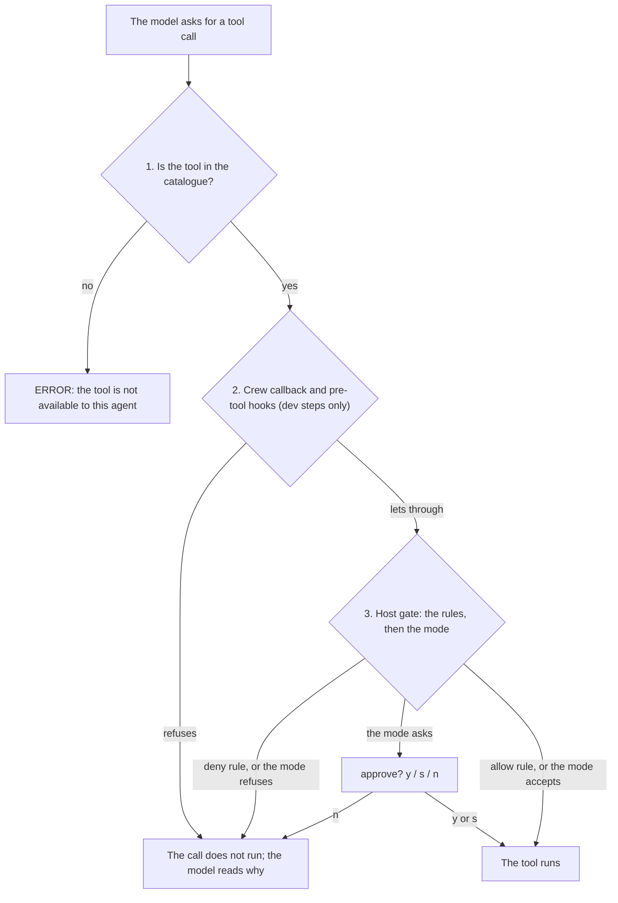

# Permissions

Every `/assistant` turn runs under a **permission mode**, and the session can add **rules**. This page says what
each mode lets the agent touch, how to choose one, how to write a rule, and what holds whatever the mode. The
mechanism behind it, rule by rule, is in the [Permissions reference](permissions-reference.md).

A tool call of the model goes through three levels, the second of them in the dev steps only:



1. **The tool catalogue.** The crew offers the model the tools of the mode, with the [extra tools](#extra-tools)
   of the classes it grants, less the tools a deny rule covers whole. A tool that is not offered cannot be called.
2. **The crew's callback**, in the dev steps only: `/dev-spec`, `/dev-plan`, `/dev-batches`, and the agent
   `/tasks repair` starts again. It checks the step's [rule sets](#rule-sets-of-the-dev-steps) and runs your
   [hooks](hooks.md). It can refuse a call, never allow one the gate refuses.
3. **The host gate.** The Orkeon runtime checks every tool call the model makes in a turn, the calls of the agent's
   `act` loop. It reads the session's rules first, then the mode, using the access each tool declares (read, edit,
   execute). When the mode says to ask, it asks you.

> [!WARNING]
> The gate is the setting `Orkeon:Security:PermissionGate:Enabled`. The launcher turns it on unless your settings
> file turns it off, and without it neither the modes nor the rules are enforced. Keep it on.

## Modes

| Mode | Offered to the model | Local reads | Network reads (`http_api`, web) | File edits (`file_write`, `edit_file`, `node_*`, `edit_batch`, `structural_rewrite`), `rag_ingest` | Shell |
|---|---|---|---|---|---|
| `plan` | local reads, `read` [extra tools](#extra-tools) | ✅ | ❌ | ❌ | ❌ |
| `dontAsk` | local reads, `read` [extra tools](#extra-tools) | ✅ | ❌ | ❌ | ❌ |
| `default` | every tool | ✅ | plain `http_api` GET ✅, its other methods ask you, web ✅ | asks you | asks you |
| `acceptEdits` | every tool | ✅ | plain `http_api` GET ✅, its other methods ask you, web ✅ | ✅ | asks you |
| `bypassPermissions` | every tool | ✅ | ✅ | ✅ | ✅ |

`plan` and `dontAsk` promise that the turn changes nothing observable: no write, and no outbound request, since a
request can carry the repository's content elsewhere. Their catalogue holds the local read tools only, and the gate
refuses anything else without asking.

### Questions

In `default` and `acceptEdits`, a call the mode asks about waits for you in the REPL:
`approve <tool>? [y] once / [s] session / [n] no`.

| Answer | Effect |
|---|---|
| `y` | runs the call |
| `s` | runs the call, and every later call of that tool without asking, until the REPL exits |
| `n` | refuses the call; the model reads the refusal and adapts |

A `/` line still runs its command while a question waits. A line that is no answer writes the whole question again.

### Questions from a background task

A question from a command running in the background (`/dev-batches`) names its task:
`? [t1] dev-batches: tool 'shell_command' requires approval (mode 'acceptEdits').`, the call, then
`approve shell_command for [t1]? [y] once / [s] session / [n] no`.

- It shows on the status line and on the task's row (`? waits for approval of shell_command`).
- You answer it from the main prompt, without opening the task.
- In the TUI, where each task has its own screen, the question shows on the screen displayed, whichever task asks.
  It is recorded once on the asking task's screen.
- `/tasks` lists the approvals waiting, under the task list: `waiting for approval:` then
  `t1 dev-batches: waits for approval of shell_command · {"command":…}`. A task blocked on you reads as such.

### What each tool declares

The gate decides from the access a tool declares: a read runs wherever the catalogue offers the tool, an edit and an
execute follow the mode's column in the table above. A tool that declares neither a read nor an edit counts as a
write. Where the access depends on the arguments, the gate reads it per call.

| Tool | Read | Edit | Execute |
|---|---|---|---|
| `http_api` | `GET`, `HEAD`, `OPTIONS`, a missing method | | any other method; a read method with a body or a method-override header |
| `github` | `list_issues`, `get_pr`, `search_repos`, `get_repo` | | `create_issue`, `create_pr`, an action it does not know |
| `web_scrape`, `scrape_element`, `rag_search` | every call | | |
| `rag_ingest`, `rag_eval` | | every call | |
| `firefox` | `navigate`, `back`, `snapshot`, `read`, `find`, `search`, `tabs`, `new_tab`, `switch_tab` | `screenshot` | `click`, `type`, `press`, `evaluate`, `close_tab`, `close` |
| `spawn_agent` | | every call | |
| `memory_recall` | every call | | |
| `memory_push` | | every call | |
| an MCP tool | what its annotations say, once its server is trusted ([Extra tools](#extra-tools)) | | |

What the table does not say, tool by tool:

- **`http_api`.** A body counts even when empty. The method-override headers are `X-HTTP-Method-Override`,
  `X-HTTP-Method` and `X-Method-Override`, in any case, in an object or a JSON string. So a plain GET runs without a
  question in `default` and `acceptEdits`, and a POST, or a GET with a body, asks you.
- **`rag_ingest`.** It writes the knowledge index, not the workspace. The catalogue offers it with the file edits:
  never in `plan` or `dontAsk`, asked in `default`, accepted in `acceptEdits`.
- **`github` and `rag_eval`.** They are offered with the file edits, in the writing modes only, whatever a call
  declares. `github` can open a pull request, and `rag_eval` ingests its corpus into a collection of the knowledge
  index and writes its reports. Neither belongs to a mode that promises nothing changes.
- **`spawn_agent`.** The runtime offers it to every act, whatever the catalogue: asked about in `default`, refused in
  `plan` and `dontAsk`. A rule may name it, and an allow rule on it holds in `dontAsk` too (`/permissions` warns when
  you add one). The child it spawns runs under the stricter of its own mode and its spawner's. Orkeon Code's
  children name none, so they take the spawner's.

### Network tools

`http_api` and the web tools stay out of `plan` and `dontAsk` for one reason: a GET is an outbound request, which
can carry the repository's content elsewhere.

> [!WARNING]
> In `default`, a plain `http_api` GET runs without a question, and its URL can hold text the model read in the
> project. A project that must not reach out denies the tool (`/permissions add deny http_api`, a deny rule holding in
> every mode), or works in `plan` or `dontAsk`, whose catalogue withholds it.

`firefox` is a network tool too: `plan` and `dontAsk` never offer it, since loading a page is an outbound request.
Where it is offered, its `action` decides, as the table says: `default` asks for a `screenshot` and `acceptEdits`
accepts it. Its own URL policy refuses private and loopback addresses. The setup is in
[Configuration](configuration.md#settings-orkeon-code-relies-on).

> [!WARNING]
> The text of a page reaches the model unscreened for prompt injection: a read of an untrusted page deserves the
> same care as `web_scrape`. A secret never goes through `type`, whose text stays in the transcript.

### The shared memory's tools

The [shared memory](shared-memory.md)'s two tools are Orkeon Code's own, offered to the REPL's turns by mode.

- `memory_recall` runs in every mode, `plan` and `dontAsk` included.
- `memory_push` writes a candidate file under `memory.dir`, never an admitted entry. It is offered where the mode
  edits: never in `plan` or `dontAsk` (the tool also refuses by itself there), asked in `default`, accepted in
  `acceptEdits`.

A rule may name them, whole or on an argument of their schema: `/permissions add deny memory_push`,
`deny memory_push topic=auth*`, `deny memory_recall query=*secret*`. A deny rule on the whole tool also takes it out
of the catalogue.

## Choosing the mode

- **Per request**: prefix the text, `plan: explain the cache layer`, `acceptEdits: fix the failing test`.
- **For the session**: `/mode acceptEdits`. Bare `/mode` opens a panel of the modes in the console; on a replay or a
  plain console it cycles through `default`, `acceptEdits`, `plan` and `bypassPermissions`, never `dontAsk` (reach it
  with `/mode dontAsk`). `/plan`, an alias of `/mode`, toggles plan mode.
- **Fallback**: with neither, the mode is `default`, or the one set by `/config set permissions.fallback <mode>`
  (`--session` keeps it for the session only). Every turn that uses the fallback says which mode applied and where
  it came from.

The command that starts the turn (`/assistant`, free text) resolves the mode before the crew loads. The catalogue,
the permission note of the prompt and the gate therefore apply the same mode: after `/mode plan`, a request without
a prefix is offered the `plan` catalogue. `/summary` does not resolve the session mode: it always runs the main crew
in `plan`.

`/permissions` shows the effective surface: the mode, the catalogue, the session's rules and the rules the gate
holds. It also reads the host and says whether the gate is on or off; off, nothing on this page is enforced and
nothing asks. The runtime always reports it.

## Rules

A rule names a tool, built in or [extra](#extra-tools), and optionally an argument pattern.

```text
/permissions add deny shell_command command=git push*
/permissions add allow shell_command command=npm test*
/permissions add deny http_api
/permissions remove allow shell_command command=npm test*
/permissions list
/permissions clear
```

### Writing a rule

- The pattern is matched whole against the argument the model passes. `*` stands for any run of characters, and case
  counts.
- A pattern may be quoted: one pair of matching quotes around it is taken off, so `command="npm test*"` is
  `command=npm test*`.
- The argument is named as Orkeon binds it, in snake_case. For a built-in tool, `/permissions add` refuses an
  argument the tool does not take and lists the ones it does.
- The arguments of an extra tool are its server's or plugin's. The rule is accepted with a warning, and matches only
  if the tool takes an argument of exactly that name.

| Tool | Arguments a rule may name |
|---|---|
| `shell_command` | `command`, `working_directory`, `timeout_seconds` |
| `file_write` | `path`, `content`, `encoding`, `append`, `create_backup` |
| `http_api` | `url`, `method`, `headers`, `body`, `content_type` |

A rule reads one top-level argument, as text. What that leaves out, and how the dev steps close the gap, is under
[What a rule reads](permissions-reference.md#what-a-rule-reads).

### How the gate reads them

The gate reads the rules before the mode, at every call:

- a **deny** rule refuses a matching call in every mode, `bypassPermissions` included;
- an **allow** rule runs a matching call without asking, in every mode but `plan`, whose gate reads none;
- a call no rule matches is decided by the mode.

Adding a rule replaces the rule of the opposite effect on the same calls; rules on other calls of the same tool stay.

### Rules and the catalogue

| Rule | Effect on the catalogue |
|---|---|
| a deny rule that covers every call of a tool | removes the tool: the model is not offered a tool whose every call would be refused |
| a deny rule with a pattern | leaves the tool offered, as its other calls run |
| an allow rule | never adds a tool: it spares a question, it does not hand over a tool the mode withholds |

`plan` and `dontAsk` therefore stay read-only whatever the rules say. `/permissions` reports an allow rule that has no
effect in the session's mode: every allow rule in `plan`, and an allow rule on a tool the mode does not offer. A turn
reports one that has none in the mode its request names, and every turn logs the tools a rule removed.

### How long they last

Rules live in the session state until `/clear` or the end of the REPL; persisting them across sessions is on the
[Roadmap](roadmap.md). The gate keeps its own copy, which `/permissions` replaces after every change and every
`/assistant` replaces before the turn starts, so the gate always holds the session's rules. A `[s]` answer is not a
rule: `/permissions` neither lists nor clears it.

## Guards that hold in every mode

The session adds deny rules of its own to the gate, in every mode, `bypassPermissions` included.

### The shared memory's guard

No file tool of the model (`file_write`, `edit_file`, `node_replace`, `node_insert`, `node_ensure`) writes under
`<memory.dir>/candidates/` or `<memory.dir>/entries/`. Candidates come from `memory_push` and the harvests, entries
from `/memory admit` alone.

- A stored allow rule the guard covers is dropped, with a warning.
- The patterns match however the path is spelt (`./`, `//`, `src/../`, `/workspace/`).
- A `shell_command` naming `<memory.dir>/candidates` or `<memory.dir>/entries` is refused too.
- `/permissions` lists the guard on its own line, "the shared memory's guard: … (N rules)".

What the gate cannot see, the callback of the main loop and of every dev crew refuses on each call, under
`orkeon run` too:

| Case | Example |
|---|---|
| a path in another letter case, which a case-insensitive filesystem opens | `.Orkeon/Memory/Entries/x.md` |
| each operation of an `edit_batch` | |
| the paths and the glob of a `structural_rewrite` that writes | `dry_run: false` |
| a shell command reaching the folder segment by segment, in any case | `cd .orkeon/memory && … > entries/x.md`, `.orkeon//memory/entries` |

A glob standing for a segment (`cp x .orkeon/mem*/entries/`) is not read: the shell expands it after every check. A
crew without a callback (`/code-review`, `/advisor`) runs under the gate's rules alone.

### The user configuration's guard

The session denies every tool of the model on the whole `/user-config` mount: the file readers and writers on
`/user-config/*`, the folder readers on the mount, a `shell_command` naming it. The launcher writes there the user
settings and `launch.json`, the physical base of each mount
([architecture](architecture.md#the-vfs-and-the-host-platform)), which the model never sees.

The code reads them through its own port, which the gate does not see. `/permissions` lists these rules as "the user
configuration's guard: no tool of the model reads or writes /user-config (N rules)".

### The path lists

`paths.deny` names the paths no tool of the model reads or writes, `paths.allow` the only paths it may reach. Both
are `/config` keys ([configuration](configuration.md#session-settings)), set by the user settings and the project
file, applied at the next start:

```text
paths.deny:  /workspace/secrets, C:\proj\keys\*, tests/fixtures/real
paths.allow: src, tests, /output
```

How an entry is written:

- Entries are separated by commas. A path may hold spaces, written bare, with no quotes.
- An entry is a virtual path, a physical spelling of a mount's base (`C:\…`, `/mnt/c/…`, `\\wsl$\…`) or a path
  relative to `/workspace`.
- `*` stands for any run of characters. A bare path covers itself and everything below it.

How the lists are read:

- The entries match on the canonical spelling, without case on a Windows disk, so no spelling bypasses them.
- An entry under no mount of this host is dropped and named by `/doctor`'s row `host: paths`.
- A deny wins over an allow. A non-empty allow refuses every path outside it, on every mount. A word of a shell
  command under no mount, such as `/dev/null`, is not judged.

The deny entries become deny rules of the gate, listed by `/permissions` on their own line: "paths.deny: no tool of
the model reads or writes … (N rules)". In every crew, the ones without callbacks of their own included, the host's
callbacks also refuse what the lists cover in any spelling: a call, each operation of an `edit_batch`, what a folder
reader reaches, and the words of a shell command. The refusal names both spellings and the entry:
"file_read on 'C:\proj\secrets\k' (/workspace/secrets/k) is refused by paths.deny '/workspace/secrets/*'".

> [!NOTE]
> On a shell command the check is best effort: what a script reaches by itself is outside it.

## What the gate does not see

Commands and crews also call tools from their own code, through Orkeon's `tools` namespace, which runs the tool
directly. Those calls are what the command you typed is for: no rule, mode or question applies to them, unless the
command checks by itself, as the table says.

| Command | What it runs from its own code | Its own check |
|---|---|---|
| `/commit` | `git add`, `git commit` and, with `--push`, `git push`, through `shell_command`; with `--pr`, `github` `create_pr` | refuses in `plan` and `dontAsk`; decides the pull request as the gate would |
| `/branch` | checks a branch out | none |
| `/diff`, `/review` | `git` | none |
| `/init` | writes the instructions file | none |
| `/init-verifiers`, `/export` | write their files | none |
| the compaction | writes the session buffer and the typed memory | none |
| `/transcribe` | the speech-to-text server's tools | none: every mode, with no `tools.extra` entry |
| `/voice`, `/say`, `voice.reply on` | record, read aloud | none |
| `/dev-learn` | reads the verdict files and both learning states, writes its own files | none |
| `/dev-spec` | reads the request, the pack and the code index, writes the spec or the change brief | refuses to start in a read-only mode |
| `/dev-plan` | reads the spec or the brief, the pack and the code index, writes the plan | refuses to start in a read-only mode |
| `/dev-batches`, one batch | the pack's restore, build and suite, then the close: commit and push | refuses to start in a read-only mode |
| `/dev-batches`, the audit | `git`, the pack's build and the test commands it accepts | none: every mode |

`/dev-spec`, `/dev-plan` and `/dev-batches` refuse to start in a read-only mode (`plan`, `dontAsk`), in a mode Orkeon
Code does not know, and when the session's mode cannot be read. All three first put the
[rule sets of the dev steps](#rule-sets-of-the-dev-steps) in the gate, and refuse to start while the gate is off.
Their crew's callback checks the same sets again, the only check of them under `orkeon run`.

### `/commit`

`/commit` stages the files it commits by name (`git add -- <files>`, then `git commit -F <message> -- <files>`,
never `-A`) and, with `--push`, pushes. With `--pr` it reads origin (`git remote get-url origin`) and calls `github`
`create_pr` itself. It decides that call as the gate would:

| Case | The pull request |
|---|---|
| `plan` | refused |
| `dontAsk` without an allow rule | refused |
| a deny rule covers the call | refused |
| an allow rule (`allow github action=create_pr`) | opened |
| `bypassPermissions` | opened |
| you answered yes to its plan that named the pull request | opened |

`--yes` asks nothing, so it needs the allow rule.

Its git commands are `git -c core.quotePath=false status`, `git --literal-pathspecs add` and `commit`, `git var`,
`git rev-parse`, `git symbolic-ref` and `git push -u origin <branch>`; for batches run in worktrees,
`git merge --ff-only` and `git -C <worktree> rebase` too. They run only under
`Orkeon:Tools:Shell:AllowInterpreters`: without it the shell tool lets git run `status`, `log`, `diff` and `show`
alone, with no option before them.

### The speech commands

- `/transcribe` calls the speech-to-text server's tools in every mode. With `--then`, the main loop makes that call
  before the turn, as the command's, and the model then works on the transcription under the turn's mode.
- `/voice` records the same way. `/voice send` hands the dictated text to a turn as typed text would: a leading
  `plan:`, in lower case, picks the mode.
- `/voice --go` hands it to a turn under the session's mode, chosen before the recording: no dictated prefix is read.
- `/say` reads aloud the same way. So does the reading of each answer under `voice.reply on`, made by the main loop
  after the turn as the launching command's call.

### What each dev step reads and writes

| Step | Reads | Writes, and nothing else |
|---|---|---|
| `/dev-learn` | the verdict files and both learning states | `<work>/learn-<date>/`, `.orkeon/dev-learn-state.json`, `refused.md` under `memory.dir` |
| `/dev-plan` | the spec or change brief, the pack, the code index | `<work>/<code>/<CODE>-PLAN.md`, the batch sheets, `plan.json` |
| `/dev-spec` | the request (an issue through `gh issue view`), the pack, the code index | `<work>/<code>/SPEC-<code>.md`, or `CHANGE-<code>.md` and `repro-<code>.txt` |

- `/dev-learn` never writes a file under `.claude/` nor the file a proposal names.
- `/dev-plan` never writes a file under `.claude/`. Its reviewer only reads, in `plan`, with the read tools.
- For a change brief, `/dev-spec` runs the reproduction or measure command from its own code, once the step's rule
  sets allow it: a narrow test command of the pack.

### One batch of `/dev-batches`

A batch (`<code> F<n>`) runs the pack's restore, build and suite from its own code. Its two roles write in
`acceptEdits`, each inside its roots. After a VALID verdict its close commits the files the roles changed, by name,
and pushes the branch, unless a session rule denies the push. The batch puts the gate check and its rules back before
each launch of its chain: the audit, then the close.

The audit (`<code> F<n> --audit`) runs `git`, the pack's build and the test commands it accepts from its own code, in
every mode. Its auditor only reads, in `plan`, with the read tools.

### A plan of `/dev-batches`

`/dev-batches` runs that chain for each batch of a plan under the same rule sets.

- Each batch's close commits without pushing, a close typed while the run is in progress too.
- The plan's close pushes the branch once, unless a session rule denies the push. It opens one pull request (`--pr`
  or `dev.prAuto`), else hands its command over.
- On the default branch it pushes nothing and hands the push over.
- Each batch runs under its own budget of tool calls, wall time and tokens.
- A GAPS verdict relaunches its batch at once in its worktree, its Blocking and Major rows as the correction, up to
  three audit rounds in GAPS.
- A batch that stops (BLOCKED, or a third audit round still GAPS) keeps its worktree, its code, sheet and verdict
  there alone. The run's last lines name it and the command that relaunches it there
  (`/dev-batches <code> --concurrency <n>`, a GAPS verdict's correction first), for a human to decide.

With `--concurrency` 2 to 4 it runs a wave of batches at once, each in a batch agent under its own worktree
(`.orkeon/worktrees/<code>-F<n>`, on the branch `batches/<code>/F<n>`). Three conditions, each refusal one line,
before any batch:

| Condition | Why |
|---|---|
| the mode is `bypassPermissions` | two batches would ask at once |
| git works inside a batch's worktree (a first probe checks it) | a sandbox may not bind the worktree's git directory |
| all of `.orkeon/` is ignored by git (`.gitignore` or `.git/info/exclude`) | the worktrees and the dev state seeded in them live there |

## Rule sets of the dev steps

`/dev-spec`, `/dev-plan` and `/dev-batches` (unless `--audit --gate-only`) hand the gate rule sets of their own just
before their crew starts, and the crew's callback checks them at each call, before the gate. A set is a list of deny
rules built into Orkeon Code, the same in every repository; no setting turns one on or off. Every step puts all of
them in force:

| Set | Rules on | Refuses |
|---|---|---|
| `git-readonly` | `shell_command`, `command` | a git command that changes the repository, its branches or its remotes, also behind a global option (`git -C <dir> push`) |
| `inline-interpreters` | `shell_command`, `command` | code handed inline to an interpreter, which could run what the other rules refuse |
| `read-noise` | `path` of `file_read`, `glob`, `grep`, `node_outline`, `node_read`, `count_pattern`, `documents_of`, `directory_search` | a read under a `bin/`, `obj/`, `.git/` or `node_modules/` folder, anywhere in the project |
| `secrets` | the written text: `file_write` `content`, `edit_file` `new_string`, `text` of `node_replace`, `node_insert` and `node_ensure`, `name` and `module` of `node_ensure`, `structural_rewrite` `fix`; each `edit_batch` operation's `text`, by the callback | content that holds a private key block or a token with a known prefix |
| `state-files` | `path` of `file_write`, `edit_file`, `node_replace`, `node_insert`, `node_ensure`, each `edit_batch` operation's `path` by the callback; `structural_rewrite` whole | a file only Orkeon Code's own code writes: the batch logs, states and verdicts, the audit captures, `.orkeon/` (but `worktrees/`) and `.claude/` |

Every rule of every set, and what each lets through, is in the
[reference](permissions-reference.md#the-rule-sets-rule-by-rule).

### What you see when a set refuses

A call the gate refuses reads the gate's own refusal. A call only the callback refuses names the rule, its set and
what to do instead: a `glob` or `grep` reaching a refused path, a path written with `./` or `..`, and every call under
`orkeon run`.

Reading the history stays open in every step: `git status`, `git log`, `git diff`, `git show`.

### When they hold

- At launch the step clears the gate, hands it the session's rules, then its own sets.
- A session allow rule on the same calls as one of the step's deny rules is left out for the run, with a warning.
- The sets are not stored with the session's rules. `/permissions list` does not show them; `/permissions` shows them
  on its `in the host gate` line, grouped by set, for as long as they stay there.
- They stay until the next `/assistant` turn or the next `/permissions add`, `remove` or `clear`, which hand the gate
  the session's rules alone.
- Like every rule, they are session-wide: a turn started while a step runs replaces them for the rest of the step.

A `/tasks repair` hands the gate the sets of the step of the instance's run. A reviewer of `/dev-spec` is repaired
under that step's sets, hooks and budget, else under its charter's step.

### What a batch adds

A batch of `/dev-batches` puts the same sets in the gate, and two allow rules of its own: `run_tests` and
`run_build`. Each checks its command against the pack and the deny rules itself, so the roles, which act in
`acceptEdits`, are not asked at each test run. The allow rules leave the gate with the step's sets.

The two writing roles (the test author and the implementer) also hold a **rewrite rule**: `deny file_write` on every
source root the pack's `layout` names (`domain`, `application`, `infrastructure`, `tests`) and every
`layout.test_files` pattern.

- An existing source file is changed by node (`node_read` for its `sha256`, then `node_replace`, `node_insert` or
  `node_ensure`) or with `edit_file`, never written whole.
- Before a `file_write` there, the callback reads the path once. When the runtime answers that the file does not
  exist, the rule is lifted for that call, so a new file (a stub, a new test file) is still created with
  `file_write`. Any other answer keeps the rule.

The pilot of a batch is kept out of the source roots the pack names: it gets the same deny rules on every path read
tool, `directory_search` included. `structural_search` and `symbol_source`, which name no path, are refused whole.

### The gate must be on

When the host says its gate is off, the steps refuse to start: every rule above, and the `plan` mode of their
auditor or reviewer, would check nothing. `/dev-batches <code> F<n> --audit --gate-only` runs no model and still
runs.

On a host that keeps no session rules, the step runs with a warning: the sets are not in the host gate, and the
crew's callback alone checks them.

### What a rule cannot see

A rule reads one argument as text.

- A script file run by an interpreter (`bash scripts/build.sh`) is not inline code, and runs.
- `secrets` knows fixed prefixes only. A JSON web token, a password in a URL or an `api_key = …` line needs a check of
  the whole content, which waits for a file tool of Orkeon Code's own.
- Content that mentions a prefix, such as a page or a test about tokens, is refused as well.
- `read-noise` also refuses a source folder that happens to be named `bin/`.
- Since a rule reads `sh -c` at the end of any word, `ssh -c <cipher>` is refused too.

In the gate, a tab between two words, or an option order a rule does not list, passes. The crews' callback closes
part of that: see [What the callback reads beyond the gate](permissions-reference.md#what-the-callback-reads-beyond-the-gate).

## Extra tools

The tools an MCP server or a plugin brings to the REPL (Orkeon's `MCP:Servers` and `Plugins` settings, see
[Configuration](configuration.md#extra-tools-mcp-servers-and-plugins)) are offered to the model once the `tools.extra`
setting names them, each with an access class:

| Class | Written | Offered in |
|---|---|---|
| `read` | `transcribe_audio:read` | every mode, with the local reads |
| `write` | `search_issues`, `create_issue:write` | `default`, `acceptEdits`, `bypassPermissions` |

A name without a class is a write. A built-in tool keeps its own class and cannot be listed.

> [!WARNING]
> Mark `read` only a tool that changes nothing and sends nothing off the machine: that is what `plan` and `dontAsk`
> promise.

### Names checked before each turn

Before each turn, `/assistant` and `/summary` check the names against the names the host registers, as Orkeon
compares them: case aside, exactly, so `get_file_contents` is not the `get-file-contents` an MCP server registers.
The turn is handed the registered spelling.

A name the host does not register (a server that did not connect, a plugin that did not load, a typo) is left out
with a warning, since Orkeon refuses a turn whose agent names a tool it does not know.

### A tool the host registers on opt-in

A tool `orkeon-repl` registers only when a settings section opts in goes through `tools.extra` as well, since a
catalogue naming a tool the host did not register fails the act before the model is asked.

`system_one_decide`, the host's System One decision model (TypeSafe, Liquid or Kev), is one: it is registered when a
decision provider is active (its section, its key or `Orkeon:Decision:Provider`) and is in no built-in list. A user
whose host has it lists it in `tools.extra`.

It declares a read to the gate, so it runs without a question wherever the catalogue offers it. Keep it a write in
the listing: it sends the state it is given to the decision provider's API, which `plan` and `dontAsk` promise
nothing does.

### What an MCP or plugin tool declares

The class shapes the catalogue; the gate still decides each call from the access the tool declares to Orkeon. An MCP
tool declares it through its annotations, read only when its server is declared with `TrustAnnotations: true`
(`MCP:Servers:<name>:TrustAnnotations`, false by default).

| The tool | Access | Effect |
|---|---|---|
| trusted server, `readOnlyHint: true` | read | runs without a question in every mode that offers the tool, `dontAsk` included |
| trusted server, another annotation | execute | asked about in `default` and `acceptEdits`, refused in `plan` and `dontAsk` |
| trusted server, no annotation | write | asked about in `default` and `acceptEdits`, refused in `plan` and `dontAsk` |
| untrusted server, whatever it annotates | write | asked about in `default` and `acceptEdits`, refused in `plan` and `dontAsk` |
| plugin tool that declares read access | read | runs in every mode |

`MCP:Servers:<name>:Tools:Deny` keeps a server tool out before any of this: it is never registered
([Configuration](configuration.md#extra-tools-mcp-servers-and-plugins)).

The speech server marks `transcribe_audio`, `list_audio` and `whisper_info` read-only, and the launchers and the
example settings declare it trusted. `record_and_transcribe`, `speak` and `stop_speaking`, which open the microphone
or the speaker, carry no annotation. For such a tool, in `dontAsk`, an allow rule lets it run
(`/permissions add allow speak`); `plan` ignores allow rules. `/transcribe` asks nothing either: its call is the
command's ([Configuration](configuration.md#speech-to-text)).

### Rules on extra tools

Rules name extra tools as they name built-in ones (`/permissions add deny create_issue`), whether the host registers
the tool or not. A stored rule on a tool `tools.extra` does not list is **dormant**:

- it stays stored as written, whatever other rule is added or removed;
- the gate does not get it;
- `/permissions` lists it as dormant and warns;
- it applies again once `tools.extra` lists the tool.

`/permissions remove` deletes it, as `/permissions clear` deletes every rule. A settings file that cannot be read is
reported as such: the extra tools are then unknown and their rules dormant, never erased.

### The dev steps' own tools

Orkeon Code adds three tools of its own to the dev steps, never offered to the REPL's turns:

| Tool | Access | Runs | Argument a rule may name |
|---|---|---|---|
| `run_validation` | read | one narrow test command of the repository pack, the auditor's, three per audit at most | `command` |
| `run_tests` | execute | the pack's narrow test command, for a writing role | `command` |
| `run_build` | execute | the pack's build, for a writing role | `project` |

The gate asks once per call from the access each declares. The shell command the tool then runs is not asked again,
so the tool checks it itself:

- the pack's own command only, a placeholder filled with one plain relative value;
- never the integration tests without a filter;
- never a restore, except one, when a build fails on a tree that was never restored;
- never a command the step's rule sets deny to `shell_command`.

A rule may also name these tools (`/permissions add deny run_build`), on the argument the table gives.

> [!NOTE]
> The command a tool runs obeys the step's rule sets, not the deny rules of your session: the crew's code cannot read
> the session's rules. `/permissions add deny shell_command ...` does not reach a validation, as it never reached the
> validations a batch's audit runs from its own code. To stop one, deny the tool itself
> (`/permissions add deny run_validation`), which the gate sees.

The agents of the dev steps, and the children of `/dev-spec`, `/dev-plan` and `/dev-batches`, are also given
[`memory_recall`](shared-memory.md) (`read`), to look for precedents in the shared memory. The agent of `/dev-learn`
has no tool, and none is given `memory_push`.

## What a project file may set

The project's `.orkeon/config.json` (what `/config set` writes) cannot widen what the user allows. The user's own
settings are the `orkeonCode` block of the user settings file (the one the launcher reads), which the launcher hands
to the session read-only, on `/user-config`:

```json
{
  "orkeonCode": { "permissions.fallback": "acceptEdits", "tools.extra": "search_issues:read, *", "paths.deny": "C:\\proj\\secrets" }
}
```

| Key, from the project file | What applies |
|---|---|
| `permissions.fallback` | only `default`, `plan` or `acceptEdits`, and never wider than the mode the user settings set |
| `tools.extra` | only the tools the user settings list too (`*` lists them all) |
| `memory.autoAdmitAudited`, `dev.prAuto` | `true` only when the user settings say `true` too |
| `paths.deny` | added to the user's list: the two are joined |
| `paths.allow` | only narrows the user's list |

- `bypassPermissions` and `dontAsk` come from the user settings or `/mode`.
- A tool stays read-only (`:read`) only when both lists say so. An invalid project entry naming a tool the project
  file also declares validly (`evil:write, evil:read`) is dropped, not reported as invalid.
- Admitting without asking and opening a pull request without asking come from the user.
- A `paths.allow` entry outside every pattern of the user's list is dropped, with a warning; with no user list, the
  project's stands. An entry in a physical spelling (`C:\…`) is kept as written and judged at the run, on this
  host's mounts.

What the project file set and could not apply, `/permissions` names: `↳ ignored` under the mode, and a note for the
tools not offered. `/doctor`'s row `settings: project file` names every such key. `/config set` of such a value still
writes it, then says it is ignored. `/config set --session` is the user's own, and is not narrowed.

## Trusted folders

The launcher asks before it starts in a folder for the first time, because the agent reads that folder's
`AGENTS.md`, `.orkeon/config.json` and `.orkeon/repo.yaml`, may run the commands `.orkeon/repo.yaml` names, and git
runs the folder's hooks through the shell. Nothing of the folder is read or mounted before the answer.

- `y` stores the folder in `~/.orkeon-code/trusted-folders.json` (`ORKEON_CODE_HOME` moves it); every folder below
  it then starts without asking. Trusting your home folder, or `/`, trusts everything below it: the question says so.
- `n`, or no answer, exits with code 0: nothing started.
- The folder is checked by its real path: a symbolic link leads to the folder it names, which is the one asked about,
  stored and mounted.
- Without a terminal (a pipe, a CI job, `scripts/run-crew.sh` in a script) an untrusted folder is refused with exit
  code 3. `--trust` starts it for that run only, and `ORKEON_CODE_TRUST=1` does the same when `CI=true`; neither
  stores anything. `--demo` trusts the fixture the launcher seeds.
- `orkeon-code trust list` shows the store, `orkeon-code trust add <folder>` and `orkeon-code trust remove <folder>`
  change it, `orkeon-code trust check <folder> [--trust]` answers 0 (it may start), 3 (refused, no terminal) or 4
  (declined).
- The launcher writes the store one folder per line and reads it back in that layout only: a file it cannot read is
  refused with its path, trusts nothing and is never rewritten. Move it away and trust your folders again.
- The check is the launcher's: `orkeon-repl` started by hand skips it.

## What no mode changes

- File tools reach only the mounts: the project on `/workspace`, `/output` and `/tmp`; `/user-config` is the
  code's alone, closed to the model's tools. A path in any spelling of the host (`C:\proj\src\a.ts`,
  `/mnt/c/proj/src/a.ts`) is read as its virtual path.
- `paths.deny` and `paths.allow` hold in every mode, `bypassPermissions` included, in every spelling.
- The shell runs allow-listed commands only (`Orkeon:Tools:Shell` extends the list), with no shell operators. A
  command that can write (an interpreter, an added command) needs the write right on every path it names and on its
  working directory.
- In tool and source modes the shell runs on your machine as your user, or under `bwrap` when
  `Orkeon:Tools:Shell:Confinement:Mode` is `Bubblewrap` (Linux); in docker mode, in the container. See
  [SECURITY.md](../SECURITY.md).

## See also

- [Permissions reference](permissions-reference.md): the order of the checks, what a rule reads, every rule of the
  rule sets.
- [Hooks](hooks.md): your commands around the model's tool calls in the dev steps.
- [Autonomous and embedded runs](headless.md): the modes of a turn nobody watches.
- [Configuration](configuration.md#session-settings): `permissions.fallback`, `tools.extra`, `paths.deny` and
  `paths.allow`.
